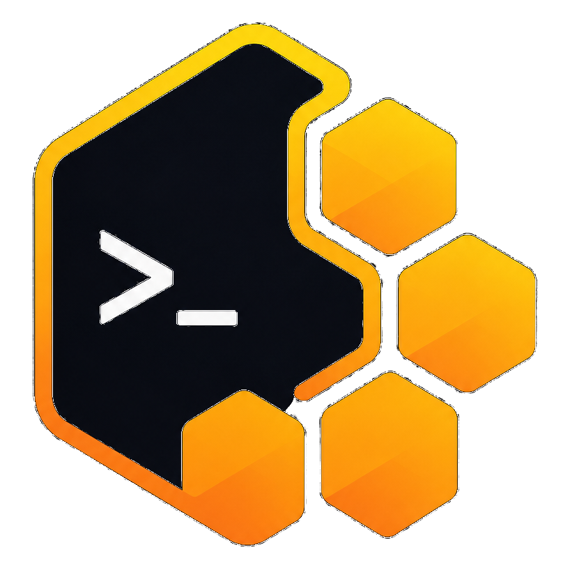

<p align="center">
  
</p>

<h1 align="center">AI Hive</h1>

<p align="center">
  <b>Every coding agent in one window.</b><br>
  A Windows desktop app that runs Claude Code, Codex, Gemini, Grok and plain
  shells side by side, tells you which agent needs you, keeps them from
  overwriting each other's work, and brings every conversation back after a
  restart.
</p>

<p align="center">
  <a href="https://thebarbellengineer.com/projects/ai-hive/">Project page</a> ·
  <a href="#install">Install</a> ·
  <a href="#install-it-with-an-agent">Install with an agent</a> ·
  <a href="CHANGELOG.md">Changelog</a> ·
  <a href="LICENSE">MIT license</a>
</p>

## Why

Running several coding agents at once usually means five terminal windows,
no idea which one is waiting on you, and two agents editing the same file.
AI Hive puts each project in a **workspace** and each agent in a **card**,
a real Windows console running the actual CLI. Nothing is emulated: what
works in a terminal works in a card. Hidden workspaces keep running, so
switching projects never pauses anything.

## What it does

### See every agent at once

- **Real terminals in a grid.** Each card runs Claude Code, Codex, Gemini,
  Grok, PowerShell, cmd, a Python script or any command you give it, in a
  real ConPTY console. Interactive TUIs, Ctrl+C, colors and mouse all work.
- **A status light per project.** The sidebar badge pulses amber while an
  agent works, stays green when they are idle, turns red on a crash and grey
  when nothing runs. The taskbar icon counts how many agents are working.
- **"?" when an agent needs you.** A permission prompt or a question lights
  a "?" on the card, the sidebar row and the taskbar, and plays a chime.
  An optional second chime rings when a reply finishes. Both sounds can be
  your own WAV or MP3.
- **A card header that tells the truth.** Conversation title, model,
  effort, permission mode and context-window fill, read live from the
  conversation, so `/model`, `/effort` and Shift+Tab changes show up within
  seconds.
- **Event log** (Ctrl+Shift+L). One timeline across every workspace:
  prompts, questions and how long they waited, finished replies, limit
  cut-offs, crashes. Filter it to **Needs you** to see only what's blocked.

### Close it, and nothing is lost

- **Each card is pinned to its own conversation** and resumes it with
  `--resume <id>` at launch, following `/clear`, `/resume` and compaction.
  Two agents in one folder never swap or overwrite each other's chats.
- **Everything that was running comes back.** Agents that were stopped come
  back showing their last screen, and start again on the first keypress.
- **Saves are atomic, with a backup**, and the session file is never
  deleted. Claude transcripts are snapshotted on every start and close.
  Only one copy of AI Hive can run at a time.

### Run agents in parallel without collisions

- **A shared board.** Agents in a workspace read `.aihive/board.md` before
  they start work and post one-line notes to it through a single
  `log_activity` tool, so they see what the others are doing. There is no
  hidden orchestrator: every agent is a terminal you drive.
- **Agent lanes** (off by default). Give an agent its own git worktree and
  branch, so it can't reset, restage or commit anyone else's work. A chip on
  each card shows commits ahead and uncommitted files, turns amber when two
  lanes touch the same file and red when they would conflict.
- **Ship finished lanes.** A laned agent marks finished work with a
  `Task done` commit after its own code review. When you decide there is
  enough to ship, one click asks the integrator agent to merge the finished
  lanes into one branch, run the tests, get a review, fix what it finds and
  merge a single pull request. Nothing ships until you click.
- **Agent/File Map.** A diagram of which agent read or edited which file.

### Keep working while you're away

- **Usage pills** in the top bar for Claude's 5-hour and 7-day windows,
  Gemini and Codex, with the reset time. They turn red at 85%.
- **Auto-continue after a limit resets.** Agents cut off by a spent plan
  limit continue by themselves when the window reopens, and again at the
  next launch if the PC was off.
- **Scheduled messages.** Type a prompt and press Ctrl+Shift+Enter to send
  it in 20 minutes, or at 03:30. Chain agents while you sleep.
- **Keep the PC awake** while AI Hive is open, and **sleep inactive agents**
  to free memory. A sleeping agent wakes into the same conversation.

### Get around fast

- **Keyboard first.** Ctrl+T new agent, Ctrl+Shift+T another one like the
  last, Ctrl+Tab next agent, Ctrl+Up maximize, F11 shows only the grid.
- **Layouts.** Auto tiling or any grid from 1x1 to 4x3. Drag cards to
  reorder them. Changing layout never restarts an agent.
- **Find in a conversation** with Ctrl+F, and a scrollbar with a dot at
  every prompt you sent, so you can jump back to any exchange.
- **Ctrl+click** a path or link in a reply to open it, right-click for
  Open with, Reveal in folder or Copy path.
- **A file explorer and repo menu** per workspace: recent pull requests and
  commits, Connect to repo, and a one-click **Sync with GitHub** for every
  workspace.

### Make it yours

- **Four themes**, switched live: Scriptorium (dark parchment and gold),
  Illuminated Manuscript (light), Adeptus Mechanicus (green phosphor CRT)
  and Obsidian (plain dark).
- **Terminal font and spacing.** Six bundled monospace fonts, including
  OpenDyslexic Mono and Atkinson Hyperlegible Mono, or your own `.ttf`, plus
  letter spacing and optional Bionic reading.
- **AI Hive updates itself** from GitHub in the background and shows what
  changed. It never restarts on its own.

## Requirements

AI Hive is a Python app for Windows. You run it from a clone of this
repository, which is also how it updates itself.

| What | Needed for | Install |
|---|---|---|
| **Windows 11** | Everything. Cards use ConPTY and Windows Job Objects. Windows 10 is untested. | |
| **Python 3.13** (64-bit) | Running AI Hive. Developed and tested on 3.13. | `winget install Python.Python.3.13` |
| **Git for Windows** 2.38 or newer | Cloning, self-update, lanes (lane conflict checks use `git merge-tree --write-tree`). Claude Code on Windows also needs its Git Bash. | `winget install Git.Git` |
| **At least one agent CLI, signed in** | The agents themselves. AI Hive starts the CLI you already use with your own account; it has no account or API key of its own. | see below |

Agent CLIs (install the ones you use; AI Hive marks any it can't find as
"CLI not detected" in the New Agent dialog):

| CLI | Command | Install | Sign in |
|---|---|---|---|
| **Claude Code** (best supported) | `claude` | `irm https://claude.ai/install.ps1 \| iex` in PowerShell | run `claude` once and log in |
| **OpenAI Codex CLI** | `codex` | `npm install -g @openai/codex` (needs Node.js: `winget install OpenJS.NodeJS.LTS`) | run `codex` once and log in |
| **Gemini** via Google's Antigravity CLI | `agy` | `irm https://antigravity.google/cli/install.ps1 \| iex` | run `agy` once and sign in with Google |
| **Grok** via the xAI CLI (Grok Build) | `grok` | `irm https://x.ai/cli/install.ps1 \| iex` | run `grok` once and log in (may need a paid xAI plan) |

Optional, for the lane workflow:

| What | Needed for | Install |
|---|---|---|
| **GitHub CLI**, logged in | Ship finished lanes (the integrator opens and merges a pull request) | `winget install GitHub.cli`, then `gh auth login` |
| **Codex CLI** | The code review lane agents and the integrator run before shipping (`codex review`) | as above |
| A GitHub remote on the project | Ship finished lanes, Sync with GitHub, the repo menu | |

Claude Code installed with the native installer above updates itself. A
winget or npm install doesn't, and an outdated CLI can't select newer
models. AI Hive's **⬇ Updates** panel can move you to the native install
and back.

## Install

In PowerShell:

```powershell
# 1. Prerequisites (skip what you already have)
winget install Python.Python.3.13
winget install Git.Git
irm https://claude.ai/install.ps1 | iex      # Claude Code; or any CLI from the table above
# open a NEW terminal so PATH picks these up, then sign in once:
claude

# 2. Get AI Hive (pick any folder; this is where it will live)
git clone https://github.com/MolnarMario/ai-hive
cd ai-hive

# 3. Install its Python packages into a local virtual environment
python -m venv .venv
.venv\Scripts\python.exe -m pip install -r requirements.txt

# 4. Launch
.\"AI Hive.bat"
```

After that, double-click **`AI Hive.bat`** in the folder to start it (it
runs `pythonw`, so no console window). To keep it on the taskbar, right-click
its taskbar icon while it runs and choose **Pin to taskbar**; the pin opens
AI Hive, not Python.

Don't start `main.py` with the system Python (a plain double-click on the
`.py` does that). The packages live in `.venv`, and AI Hive tells you so in
a dialog if it happens.

## Install it with an agent

Paste this into Claude Code, Codex or any agent that can run PowerShell:

````text
Install AI Hive (https://github.com/MolnarMario/ai-hive) on this Windows machine.

1. Check what is already installed and only install what is missing:
   - Python 3.13: `py -3.13 --version` or `python --version`.
     If missing: `winget install Python.Python.3.13`.
   - Git 2.38 or newer: `git --version`. If missing or older: `winget install Git.Git`.
   - At least one agent CLI: `claude --version`, `codex --version`, `agy --version`, `grok --version`.
     If none, ask me which ones I want, then install them in PowerShell:
     Claude Code `irm https://claude.ai/install.ps1 | iex`,
     Codex `npm install -g @openai/codex` (needs Node.js: `winget install OpenJS.NodeJS.LTS`),
     Gemini (Antigravity) `irm https://antigravity.google/cli/install.ps1 | iex`,
     Grok `irm https://x.ai/cli/install.ps1 | iex`.
   After installing anything, tell me to open a new terminal if the command is still not found.
2. Ask me which folder AI Hive should live in (default: my user folder), then
   `git clone https://github.com/MolnarMario/ai-hive` there. Do not download a zip:
   AI Hive updates itself through git.
3. In the clone: `python -m venv .venv` (use `py -3.13 -m venv .venv` if `python`
   is another version), then `.venv\Scripts\python.exe -m pip install -r requirements.txt`.
4. Verify: `.venv\Scripts\python.exe -c "import PySide6, winpty, pyte, win32api; print('ok')"`
   must print ok.
5. Do not run the test suite and do not edit any file in the clone.
6. Tell me to start it by double-clicking "AI Hive.bat" in that folder, and that each
   agent CLI must be signed in once (run `claude`, `codex`, ... in a terminal) before
   AI Hive can use it. If I want the lane workflow, also tell me to install the GitHub
   CLI (`winget install GitHub.cli`, then `gh auth login`).
````

## First ten minutes

1. **Add a workspace.** Click **+** in the sidebar (or Ctrl+Shift+N) and pick
   a project folder. You can also paste a GitHub URL to clone it, or type a
   path that doesn't exist yet to create it.
2. **Add agents.** Press **Ctrl+T**, pick **Claude Code**, choose model,
   effort and mode, set **Count** to 3 and click Create. To pick up an older
   conversation instead, choose it in the **Conversation** list.
3. **Give each one a task** by typing into its card. Watch the sidebar
   badge and the "?" to see who is working and who needs you.
4. **Turn on Lanes** in the workspace header (git projects) before adding
   agents if they will change code at the same time. Each new agent then
   works on its own branch.
5. **Close AI Hive and open it again.** Every agent comes back in its own
   conversation.

Open **⚙ Options** in the top bar for every setting, and **Options > Help >
Keyboard shortcuts** for the full list.

## Shipping work with lanes

Lanes are for git projects where several agents change code at once.

1. Turn on **Lanes** in the workspace header, or tick **Own lane** in the
   New Agent dialog. Each laned agent gets a worktree next to the repo
   (`<repo>.lanes\<name>-<id>`) on branch `hive/<name>-<id>`.
2. Pick one agent as the **integrator**: hover the card's `⋯` and click
   `⚑` **Make integrator**. It needs `Bash(git:*)` and `PowerShell(git:*)`
   allowed in Claude Code, a GitHub remote and a logged-in `gh`.
3. The other agents work as usual. When one finishes, it merges the newest
   `main`, gets a Codex review, fixes what it finds, and commits `Task done`.
   Its chip gets a check mark and turns green.
4. When you want to ship, click the integrator's chip and choose **Ship
   finished lanes**. It merges the finished lanes into one `integrate/`
   branch, tests it, opens a pull request, gets it reviewed until clean and
   merges it with a merge commit.
5. **Close merged agents** on the same chip closes the agents whose work
   landed and removes their lanes.

A project can describe its own release steps in
`docs/agents/integration.md` on its base branch, and the integrator follows
them. AI Hive's own is in this repository. The **?** beside the Lanes
toggle explains lanes in terms of how a team worked before AI.

## Updating

AI Hive checks GitHub about a minute after it opens and then every hour
(**Options > Update AI Hive in the background**). When a newer version is
ready, the refresh button next to the version badge reads **Restart to
update** and shows the changelog. It restarts only when you click, and
offers to wait for working agents first.

It only ever fast-forwards `main`. A clone that is on another branch, has
local changes to tracked files or has local commits is left alone, and the
button says why. By hand:

```powershell
git pull --ff-only
.venv\Scripts\python.exe -m pip install -r requirements.txt
```

## Where your data lives

| What | Where |
|---|---|
| Workspaces, agents, settings | `%APPDATA%\AIHive\AI Hive\session.json` (plus `session.json.1`, the previous save) |
| Forensic log of saves, launches, lanes | `%APPDATA%\AIHive\AI Hive\session.log` |
| Event log | `%APPDATA%\AIHive\AI Hive\event_log\` (one file per day, 30 days) |
| Transcript backups | `%APPDATA%\AIHive\AI Hive\transcripts\` |
| Shared board | `<project>\.aihive\board.md` and `board-archive.md` |
| Lanes | `<repo>.lanes\` next to each repository |

Your conversations stay where each CLI keeps them (for Claude Code,
`%USERPROFILE%\.claude\projects\`). To uninstall, close AI Hive and delete
its folder and `%APPDATA%\AIHive`. Add `.aihive/` to a project's
`.gitignore` if you don't want the board committed.

## Troubleshooting

| Symptom | Fix |
|---|---|
| Double-clicking does nothing, or "The project venv is missing" | Run step 3 of [Install](#install) in the AI Hive folder. |
| "CLI not detected" in the New Agent dialog | Install that CLI, open a new terminal and check `claude --version` (or `codex`, `agy`, `grok`). AI Hive also looks in the usual install folders; if it still can't find it, restart AI Hive so it gets the new PATH. |
| An agent opens and asks you to log in | Each CLI uses its own sign-in. Log in once in the card, or in a normal terminal. |
| A second AI Hive won't open | Only one copy can run. Look for it in the taskbar, or in Task Manager as `pythonw.exe`. |
| Claude can't use a newer model | Your Claude Code is out of date. Use **⬇ Updates** to switch to the self-updating install, or reinstall with the native installer. |
| A console window flashes briefly | That is Antigravity (`agy`) checking Gemini usage. Close the two Gemini pills with their ✕ if you don't use Gemini. |
| Ship finished lanes fails | Check `gh auth status`, that the project has a GitHub remote, and that the integrator may run `git` without asking. |
| Something else | Look at the newest lines of `%APPDATA%\AIHive\AI Hive\session.log`, and open an issue with them. |

## Keyboard shortcuts

App shortcuts use Ctrl+Shift so every plain Ctrl and Alt key reaches the
focused terminal.

| Keys | Action |
|---|---|
| Ctrl+T | New agent |
| Ctrl+Shift+T | New agent set up like the last one, no dialog |
| Ctrl+Shift+N | New workspace |
| Ctrl+Tab, Ctrl+Shift+Tab | Next, previous agent |
| Ctrl+Up, Ctrl+Down | Maximize the selected agent, show all again |
| Ctrl+Shift+B | Show or hide the sidebar |
| Ctrl+Shift+L | Event log |
| F11 | Fullscreen, only the agent grid |
| Ctrl+F | Find in the conversation |
| Ctrl+Shift+Enter | Send what you typed later |
| Ctrl+C | Copy the selection, or interrupt when nothing is selected |
| Ctrl+V, Ctrl+Shift+V | Paste (an image is pasted as a file path) |
| Ctrl+Plus, Ctrl+Minus | This agent's font size |
| Ctrl+click | Open a path or link |
| Shift+Tab | Cycle Claude Code's permission modes |

## How it works

- **Agents belong to the model, not the window.** Each agent is a process
  owned by the workspace manager; cards only display it. That is why hidden
  workspaces keep running and a layout change never restarts anything.
- **Real consoles.** Full-terminal cards run the CLI in a Windows
  pseudo-console via pywinpty and render it with pyte. Line-console cards
  are lighter piped shells for line-oriented commands.
- **Clean process trees.** Every card's process tree sits in a Windows Job
  Object, so closing a card, or AI Hive crashing, takes every child and
  grandchild with it. A graceful stop is end-of-input, never a kill.
- **One narrow bridge.** The only thing an agent can ask of AI Hive is
  `log_activity`, a stdlib MCP server talking to the app over a named pipe,
  scoped to its own workspace. Agents can't start, stop or retask each
  other.
- **Conversation tracking.** A Claude `SessionStart` hook reports each
  agent's live conversation id, so `/clear` or `/resume` inside a card
  moves the pin with it.

## Reliability rules

Each of these has a regression test:

- Adding or removing an agent or workspace saves immediately; other changes
  save within seconds, and a safety-net autosave catches anything missed.
- A save is never silent. Skipped and failed saves leave a line in
  `session.log`, and one broken agent can't stop the rest from saving.
- Saves are atomic (temp file, then rename). A file that fails to load is
  kept as `.json.bak`, never deleted.
- A kernel mutex lets only one copy run, and fails closed.
- Pinned agents resume with `--resume <id>`, never `--continue`, so two
  agents in one folder can't race for the same conversation.
- Lane removal never uses `--force` or `-D`, and unlinks the lane's
  `.venv` and `node_modules` junctions first so git can't empty the real
  ones.
- The close and reopen journey is tested end to end against a real Claude
  Code agent.

## Development

```powershell
.venv\Scripts\python.exe tests\smoke_test.py            # everything, before a merge
.venv\Scripts\python.exe tests\smoke_test.py --quick    # skip the real-Claude e2e test
.venv\Scripts\python.exe tests\smoke_test.py -m lanes   # one area: tests/smoke/lanes.py
.venv\Scripts\python.exe tests\smoke_test.py -k NAME    # tests whose name matches
.venv\Scripts\python.exe tests\smoke_test.py -k NAME -j 1  # one process
```

5008 checks drive the real app headlessly with real child processes, in up
to six worker processes, each in a throwaway Windows profile so a test can
never touch your real session. The final end-to-end test talks to a live
Claude Code agent for about two minutes, closes and reopens the app, and
checks the same conversation comes back on the same card. Any other test
that tries to start a real AI CLI fails the run.

Contributor rules, mostly the ones that protect user data, are in
[`CLAUDE.md`](CLAUDE.md). Release steps are in
[`docs/agents/integration.md`](docs/agents/integration.md). Design notes
live in each module's docstring.

```
main.py                 entry point, single-instance guard, window factory
AI Hive.bat             launcher (pythonw from .venv)
app/
  workspace_manager.py  the model: workspaces, agents, spawn and retire
  terminal_agent.py     one agent: worker, buffer, lifecycle
  pty_worker.py         ConPTY engine (full-terminal cards)
  process_worker.py     QProcess engine and Job Object (line consoles)
  providers.py          Claude, Codex, Gemini, Grok: models, flags, detection
  session_store.py      atomic session persistence and the save audit
  coordination.py       the shared board and agent prompts
  lanes.py, lane_ops.py, lane_service.py   agent lanes
  mcp_server.py         the log_activity MCP server (stdlib only)
  claude_usage.py, usage_poll.py           usage pills
  self_update.py        updating AI Hive from GitHub
  widgets/              the Qt UI
tests/
  smoke_test.py         test runner
  smoke/<area>.py       tests, one module per area
docs/agents/            integrator checklist, terminal rendering, issue tracker
tools/                  render capture and replay for terminal bugs
```

## License

[MIT](LICENSE). Built by Mario Molnar, mostly by agents running inside AI
Hive itself.
